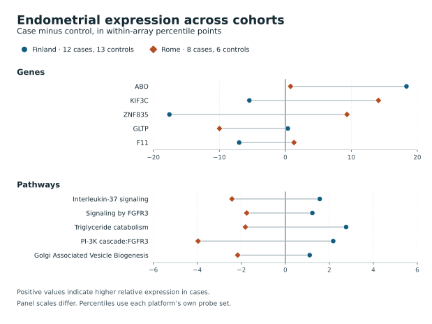

# Genome-wide endometriosis screen in Finland and external validation in Rome

**November 14, 2026 · Exploratory human-data computation with a prospectively locked external test.** None of 12,044 genes or 1,049 Reactome pathways cleared the Finnish discovery threshold. None of the five nominated genes and five nominated pathways passed external validation. Nine of the ten estimates reversed direction in Rome, including all five pathway estimates. This screen found no reproducible directional association under its published criteria. Its small cohorts cannot rule out clinically or biologically important effects. [Protocol commit](https://github.com/dovvnloading/Open-Disease/commit/94dc9a2965cea7640d37be11286c9df962650f12) · [Nomination commit before validation](https://github.com/dovvnloading/Open-Disease/commit/f2a3755ff055cde241e0eaaaedc11a1471270beb) · [All aggregate results](../../evidence/cross-cohort-2026-11-14)



## What was tested

Finland contributed 12 affected women and 13 controls with uterine endometrium on a physically verified HumanWG-6 v2 chip. We compared cases with controls inside each of seven shared assay-run and histologic-phase groups and gave each group equal weight. Rome contributed eight affected women and six surgical controls, all proliferative-phase uterine biopsies on a different array. We excluded eight paired lesion arrays from the Rome study. Recruitment was separate. The source design supports one biopsy per included woman, although Rome does not provide an individual donor crosswalk. [Finnish donor and chip census](GSE141549_CHIP_CENSUS_2026-11-14.md) · [Rome sampling and input provenance](GSE25628_FOSB_RESULTS_2026-11-13.md)

For each woman, we measured where a probe ranked among all measured probes on her array, then averaged mapped probes within each Entrez gene. Pathway scores were the means of the shared genes in the specified Reactome sets. A difference of one percentile point is a shift in relative expression rank. It does not quantify a fold change or pathway activation. Finland had 48,701 reference addresses and Rome had 22,277 complete reference probes. There were 12,045 shared mapped genes, including the previously studied FOSB. Its prospective exclusion left 12,044. After removing the human Disease chapter, applying coverage and size rules, and collapsing identical covered memberships, 1,049 pathways qualified. All features had nonzero within-stratum variation. [Frozen methods](CROSS_COHORT_DISCOVERY_PLAN_2026-11-14.md)

We evaluated every candidate against all 12,096 permissible Finnish assignments of case labels and calibrated each family against its largest absolute standardized statistic (maxT). The discovery cutoff was 0.025 per family. The protocol required us to nominate candidates even if none met that cutoff. Five genes and five pathways were selected using Finnish data alone. Their membership and direction were committed before examining the new Rome outcomes. In Rome, we tested precisely those directions with all 3,003 assignments and Holm-adjusted the ten one-sided tests together. All ten adjusted p-values were 1. [Full gene screen](../../evidence/cross-cohort-2026-11-14/discovery_gene.tsv) · [Full pathway screen](../../evidence/cross-cohort-2026-11-14/discovery_pathway.tsv) · [Locked candidates and gene memberships](../../evidence/cross-cohort-2026-11-14/nominations.json)

| Nominated gene or pathway | Finnish difference, pp | Finnish maxT p | Rome difference, pp | Rome one-sided p |
| --- | ---: | ---: | ---: | ---: |
| ABO | +18.36 | 0.8290 | +0.79 | 0.358 |
| KIF3C | −5.45 | 0.9264 | +14.11 | 1.000 |
| ZNF835 | −17.57 | 0.9568 | +9.34 | 0.9997 |
| GLTP | +0.37 | 0.9597 | −9.98 | 0.999 |
| F11 | −7.00 | 0.9621 | +1.31 | 0.784 |
| Interleukin-37 signaling | +1.57 | 0.0401 | −2.43 | 0.982 |
| Signaling by FGFR3 | +1.23 | 0.1257 | −1.76 | 0.999 |
| Triglyceride catabolism | +2.76 | 0.2191 | −1.82 | 0.947 |
| PI-3K cascade downstream of FGFR3 | +2.18 | 0.4069 | −3.97 | 1.000 |
| Golgi-associated vesicle biogenesis | +1.11 | 0.4626 | −2.17 | 0.998 |

For the leading Finnish pathway, interleukin-37 signaling, only three assignments were as extreme for that pathway alone. When all pathways competed within each assignment, 485 of 12,096 were as extreme (p = 0.0401). The strongest apparent pathway signal thus missed the frozen discovery cutoff even before its negative external estimate. ABO was the only nomination with the same sign in both cohorts. In Rome its effect ranged from −0.17 to +2.47 on deleting one biopsy. Each of the five Rome pathway estimates stayed negative on deleting any single biopsy. Some sets share genes, including the 18-gene PI-3K set nested in the 38-gene FGFR3 set; five sign reversals are correlated observations. [Exact validation counts and deletion ranges](../../evidence/cross-cohort-2026-11-14/validation.tsv)

## What the phase diagnostic establishes

We specified this secondary diagnostic after seeing the Rome sign reversals. Finnish proliferative and secretory contrasts were calculated separately for all ten frozen nominations. Every nominated pathway remained higher in Finnish cases in each phase. For IL-37 signaling the difference was +1.75 percentile points across four Finnish proliferative run groups, +1.33 across three Finnish secretory groups, and −2.43 in proliferative Rome. The discrepancy persists with both cohorts restricted to the same broad phase. This comparison uses the original selected cases and does not identify the reason for reversal. [Dated secondary plan](CROSS_COHORT_PHASE_SENSITIVITY_PLAN_2026-11-14.md) · [All phase results](../../evidence/cross-cohort-2026-11-14/phase_sensitivity.tsv)

The cohorts differ in recruitment, control indications, platforms and potentially in treatment, tissue composition and precise cycle timing. The Finnish hormone-medication column defaults to false with no dated washout. Rome does not establish individual recent exposure or per-array laboratory batch. The Finnish permutation test assumes label exchangeability within the audited groups, and the Rome test assumes exchangeability across its 14 women. A gene can shift rank when other transcripts change. A negative validation result does not distinguish any of these explanations. Prior human work examined IL-37 in uterine tissue, and previous analyses used both public series. These findings do not establish a new disease mechanism. [Candidate-specific primary evidence and cohort reuse](CROSS_COHORT_PRIOR_EVIDENCE_2026-11-14.md)

## Follow-up in other study populations

The separately frozen [Melbourne five-gene analysis](MELBOURNE_FIVE_GENE_RESULTS_2026-11-14.md) tested GLTP using the published cycle-adjusted probe statistics. The other four nominated genes were outside the high-detection table. The [Swiss epithelial feasibility audit](GSE266265_EPITHELIAL_FEASIBILITY_2026-11-14.md) traced the clinical and laboratory batch keys for an independent cell-type resource and assessed which measurements could support a donor-level comparison. The subsequent [Swiss glandular analysis](SWISS_GLANDULAR_RESULTS_2026-11-14.md) found all five primary pathway scores higher in cases, with an inconclusive joint test (p = 0.167).

## Independent verification and reproduction

An independently implemented Finnish calculation reconstructed gene scores with sorted signal positions and obtained standard deviations from the complete permutation distributions. All 13,093 raw and maxT tail counts, nomination order and directions agreed exactly. Floating-point effect differences were below 1.5 × 10⁻¹⁴ percentile points. As a compatibility check, the previous FOSB sentinel reproduced +10.8910 points and 1,925 extreme assignments. FOSB remained outside both screening families. Independent base R parsing of the Rome matrix and separate enumeration agreed on every one of the ten extreme counts and Holm results. Effect and omission-bound differences were below 4 × 10⁻¹⁴ points. [Finnish verifier](../../scripts/verify_finnish_genome_screen.py) · [Rome verifier](../../scripts/r/verify_rome_pathway_screen.R)

Use the standard project installation plus `inflate64==1.0.4` for the Finnish archive. The [Finnish census](GSE141549_CHIP_CENSUS_2026-11-14.md) documents the exact native release prefix, two clinical ranges and three manufacturer manifests. The genome loader accepts the documented `data/private/gse141549/raw-prefix.zip.part` or the original segmented cache. The [Rome input instructions](GSE25628_FOSB_RESULTS_2026-11-13.md) provide the two compressed files and hashes. The current study reused these cached human-cohort inputs. Only the three public annotation files below were newly acquired (99,480,439 bytes total).

| Local filename under data/private/pathway-atlas | SHA-256 |
| --- | --- |
| NCBI2Reactome_All_Levels.v98.txt | `272ca73c16eb285be1698e07c81912335a1d3804e125f789f5160dff150be243` |
| ReactomePathwaysRelation.v98.txt | `aa3609ee852442899b400bf4817b36311d820883ecd75259ed77531d93d8f1dc` |
| ReactomePathways.v98.txt | `b8103a50d625ffb6acd18cddffcce0ceb0fdf36b19392d104c32bb1fcc7e2f9f` |

Human pathway names, hierarchy and source memberships are from Reactome release 98, licensed CC BY 4.0. Open-Disease projected the memberships onto the two chip annotations, excluded the Disease chapter and FOSB, and filtered and deduplicated the resulting sets. The published gene lists are these project-specific projections. [Reactome data](https://reactome.org/download-data) · [License and attribution](https://reactome.org/license)

```bash
mkdir -p data/private/pathway-atlas
for table in NCBI2Reactome_All_Levels ReactomePathwaysRelation ReactomePathways
do
    curl --fail --location --max-filesize 98000000 \
      "https://download.reactome.org/98/${table}.txt" -o "data/private/pathway-atlas/${table}.v98.txt"
done
export OPENBLAS_NUM_THREADS=1 OMP_NUM_THREADS=1
data=data/private
out=results/cross-cohort-pathway-discovery
locked=evidence/cross-cohort-2026-11-14/nominations.json
python scripts/cross_cohort_discovery.py discover --data "$data" --out "$out"
python scripts/cross_cohort_discovery.py validate --data "$data" --lock "$locked" --out "$out"
python scripts/verify_finnish_genome_screen.py --finland "$data/gse141549" --rome "$data/gse25628" \
  --pathways "$data/pathway-atlas" --output results/cross-cohort-discovery-verify --compare "$out"
python scripts/verify_rome_pathway_screen.py "$data" "$locked"
python scripts/describe_cross_cohort_phase.py --finland "$data/gse141549" --lock "$locked" \
  --validation "$out/validation.tsv" --output "$out/phase_sensitivity.tsv"
```

CPython 3.12.14, NumPy 2.3.5, SciPy 1.17.0, inflate64 1.0.4 and base R 4.5.0 were used. The computations enumerate their null distributions without a random seed. The primary screen took 39.94 s with peak RSS 1,185,512 KiB. External validation took 3.60 s and 115,460 KiB. A fresh execution reproduced the four primary output files byte for byte. The independent Finnish verifier took 40.18 s, with peak RSS 1,158,248 KiB. Synthetic tests cover the two cohort mappings, ties, projection and deduplication, family-wide calibration, Holm adjustment, sign locking and phase reconstruction. The checked-in tables contain aggregate features and contrasts only.
