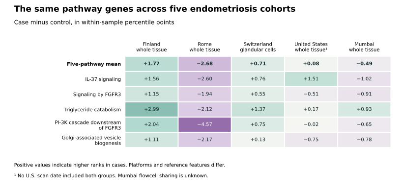

# Two whole-tissue tests of five endometriosis pathways

**Exploratory human-data computation, November 14, 2026.** Among four cases and three controls in Mumbai, the combined pathway score was **0.60 percentile points lower in cases**. Seventeen of 35 possible label assignments yielded an absolute difference at least this large (two-sided p = 0.486). Among six cases and five controls in the U.S., the score was **0.27 points higher in cases**. No U.S. scan date contained both groups. These cohorts leave the direction of a general endometriosis-associated expression shift unresolved. [Prospective protocol](https://github.com/dovvnloading/Open-Disease/commit/fe541f1e113de0b41cfc283b9e16ae2456a28f5c) · [All estimates and tested memberships](../../evidence/external-bulk-2026-11-14/results.json)

## What the scores measure

The original Finnish screen nominated five Reactome pathways before evaluation in Rome. The protocol for the two new comparisons fixed cohort eligibility, the gene coverage threshold, scoring, statistical decisions and sensitivity analyses before computing the group differences. In each biopsy we ranked features from low to high, retained measured zeros and used the midpoint for ties. We averaged the measured gene percentiles in each pathway and gave the five pathways equal weight. A positive difference means the selected genes ranked higher, on average, in cases. The relative rank has no fixed conversion to a fold change or a measure of protein signaling. [Candidate lock and original validation](CROSS_COHORT_DISCOVERY_RESULTS_2026-11-14.md) · [Detailed protocol](EXTERNAL_BULK_PATHWAYS_PLAN_2026-11-14.md)

Both platforms measured 117 distinct locked genes. All five pathways met the requirement of at least 15 measured genes and 80% coverage. All 17 measured genes in the downstream PI-3K cascade also belong to the 37-gene FGFR3 set. Their scores thus share expression measurements. The repeated membership is part of the frozen endpoint. [Membership identifiers](../../evidence/external-bulk-2026-11-14/results.json)

## Mumbai whole-tissue RNA sequencing

The seven mid-proliferative biopsies were histologically dated. Controls were assessed at laparoscopy, and the source study excluded medication or oral contraceptive use in the preceding three months. The deposited RNA-seq subgroup lacks individual surgical stage information. For each biopsy, we mapped transcripts with GENCODE v19 and the frozen HGNC snapshot. Of 145,630 transcript rows, 137,391 had unique GENCODE mappings and 130,773 mapped through to the 24,977 genes in the rank denominator. We summed transcript FPKMs within gene before ranking. Alternative scoring ranked all original transcripts first and averaged mapped ranks within gene. Seven distinct archive runs were identifiable, but the archive-rewritten read names did not identify shared physical sequencing lanes, flowcells or preparation batches. Exchangeability of case and control labels remains an assumption. [Source paper](https://doi.org/10.1093/humrep/deaa255) · [GEO](https://www.ncbi.nlm.nih.gov/geo/query/acc.cgi?acc=GSE153739) · [Source and mapping audit](../../evidence/external-bulk-2026-11-14/mumbai-source.json)

All estimates are case minus control, in within-biopsy percentile points. Omission ranges give the minimum and maximum after dropping one biopsy. The final column restricts each pathway to the exact genes available in the Swiss analysis.

| Endpoint | Common / locked genes | Primary | Exact tail | Two-sided p | Holm p | Omit-one range | Transcript-first | Swiss members |
| --- | ---: | ---: | ---: | ---: | ---: | ---: | ---: | ---: |
| **Five-pathway mean** | 117 distinct | −0.595 | 17 / 35 | 0.486 | — | −1.091 to −0.067 | −0.963 | −0.486 |
| Interleukin-37 signaling | 19 / 19 | −1.257 | 21 / 35 | 0.600 | 1.000 | −3.181 to +0.641 | −1.854 | −1.023 |
| Signaling by FGFR3 | 37 / 38 | −0.781 | 13 / 35 | 0.371 | 1.000 | −1.156 to −0.303 | −0.722 | −0.912 |
| Triglyceride catabolism | 19 / 21 | +0.350 | 28 / 35 | 0.800 | 1.000 | −0.775 to +1.897 | −0.880 | +0.932 |
| PI-3K cascade downstream of FGFR3 | 17 / 18 | −0.510 | 26 / 35 | 0.743 | 1.000 | −1.405 to +0.204 | −0.448 | −0.649 |
| Golgi-associated vesicle biogenesis | 43 / 43 | −0.780 | 13 / 35 | 0.371 | 1.000 | −1.025 to −0.336 | −0.910 | −0.780 |

The 95% compatibility interval for a constant additive shift in the combined score extends from **−4.29 to +2.87 points**, obtained by inverting the same unblocked test. Two assignments entered the tail at each boundary. The global test missed its 0.05 threshold. The smallest attainable unadjusted p-value is 1/35, already above the first five-pathway Holm threshold of 0.01. The negative combined estimate survived every single-biopsy omission, but the interval includes shifts in either direction. Triglyceride catabolism changed sign under transcript-first scoring. [Exact tails and sensitivities](../../evidence/external-bulk-2026-11-14/results.json)

## U.S. whole-tissue microarrays

GSE6364 contained 37 biopsies across three cycle stages. The 11 proliferative biopsies comprised six surgically confirmed moderate or severe cases and five surgically disease-free comparators. The authors reported using controls from an earlier experiment. The complete array contributed 54,675 probes to the within-biopsy rank denominator. After excluding array controls, ambiguous probes and unmapped features from gene summaries, 42,891 probes mapped unambiguously to 20,845 genes. The primary score used each gene's mean probe percentile. The alternate used its median. [Source paper](https://doi.org/10.1210/en.2006-1692) · [GEO](https://www.ncbi.nlm.nih.gov/geo/query/acc.cgi?acc=GSE6364) · [GPL570 annotation](GPL570_ANNOTATION_RESULTS_2026-11-13.md)

| Endpoint | Primary | Omit-one range | Median probe | Swiss members |
| --- | ---: | ---: | ---: | ---: |
| **Five-pathway mean** | +0.266 | +0.026 to +0.605 | +0.187 | +0.078 |
| Interleukin-37 signaling | +1.281 | +0.942 to +1.591 | +1.603 | +1.505 |
| Signaling by FGFR3 | −0.045 | −0.462 to +0.346 | −0.381 | −0.510 |
| Triglyceride catabolism | +0.025 | −0.394 to +0.665 | +0.168 | +0.166 |
| PI-3K cascade downstream of FGFR3 | +0.823 | −0.004 to +1.539 | +0.370 | −0.020 |
| Golgi-associated vesicle biogenesis | −0.752 | −1.028 to −0.473 | −0.826 | −0.752 |

The native CEL headers identify one scanner and six dates. The six case arrays were scanned on three dates (one, one and four arrays). The five controls were scanned on three different dates (one, one and three arrays). Holding the case count fixed on each date leaves exactly **one** possible assignment. Disease and scan date cannot be distinguished in this design. The positive combined estimate survived single-biopsy omission and diminished to +0.08 with the Swiss members. The PI-3K estimate fell from +0.823 to −0.020 under that restriction. [Native scan audit](../../evidence/external-bulk-2026-11-14/us-source.json)

### Physical scan reuse across archives

After computing the endpoints, we quantified the historical overlap by comparing native image headers and four grid-corner coordinates across file encodings. **Eight of the eleven GSE6364 scans** have an exact match in GSE51981 (five cases and three controls). **Four of five control scans** have an exact match in GSE4888. Three scans match both archives, so **nine of eleven** have a match in at least one. These counts establish reuse of specific physical measurements across archives. Unmatched headers cannot establish distinct participants. The present five-cohort comparison includes GSE6364 only once and uses no expression estimates from either comparison archive. Our finding matters for training/validation splits and pooled studies that would otherwise treat these accessions as independent. [Aggregate source audit](../../evidence/external-bulk-2026-11-14/us-source.json) · [GSE51981](https://www.ncbi.nlm.nih.gov/geo/query/acc.cgi?acc=GSE51981) · [GSE4888](https://www.ncbi.nlm.nih.gov/geo/query/acc.cgi?acc=GSE4888)

The eight GSE51981 matches agree on proliferative phase and case–control status. Five were labeled moderate/severe endometriosis, and three controls were labeled free of uterine or pelvic pathology. In GSE4888, three matched controls were described as volunteers and one as having leiomyomata. A comparator free of endometriosis can still have other uterine pathology. [Matched source categories](../../evidence/external-bulk-2026-11-14/us-source.json)

The original GSE6364 study disclosed earlier control use. A later integrated expression study also reported removing duplicates across studies including GSE4888 and GSE6364. This audit supplies counts for the locked proliferative subset using native scan evidence. It does not establish priority for recognizing dataset reuse. [Original study](https://doi.org/10.1210/en.2006-1692) · [Previously reported duplicate removal](https://doi.org/10.7717/peerj.10171)

## Comparison on identical genes

Restricting the five pathways to the **111 distinct Swiss-measured genes** preserved every Swiss pathway member in both new studies. The matched pathway sizes are 18, 33, 18, 15 and 43 in the table order above. The five-pathway means were **+1.77** in Finnish whole tissue, **−2.68** in Rome whole tissue, **+0.71** in Swiss glandular cells, **+0.08** in U.S. whole tissue and **−0.49** in Mumbai whole tissue. Matching the measured genes leaves the sign differences intact. Study populations, cycle-phase distributions, cell composition, rank reference features and technical handling still differ. The Finnish score comes from the study that selected the pathways. The five estimates do not establish a common disease direction or identify which difference between studies produced the disagreement. [Prior matched calculations](../../evidence/swiss-glandular-2026-11-14/prior-cohorts.json) · [Swiss analysis](SWISS_GLANDULAR_RESULTS_2026-11-14.md)



## Reproduction

A second implementation independently parsed the two expression sources and their annotations, computed sorted midranks, and used exact fractions for the contrasts. Both calculations use the same deposited data, frozen candidate lists, Swiss projection and annotation snapshots. They agreed on all 12 primary estimates, every reported sensitivity, the exact gene identifiers, the six Mumbai tail counts, the five Holm values, the compatibility bounds and the U.S. assignment count. The largest absolute difference was 3.01 × 10⁻¹⁴ percentile points. The two calculations verify implementation reproducibility within these datasets. [Verification receipt](../../evidence/external-bulk-2026-11-14/verification.json) · [Independent implementation](../../scripts/verify_external_bulk_pathways.py) · [Gene-only Swiss projection](../../evidence/external-bulk-2026-11-14/locked_hgnc_projection.tsv)

From the repository root, install the project development dependencies and matplotlib with `python -m pip install -e ".[dev]" matplotlib`. The source fetcher acquires missing public inputs into the ignored data directories and verifies the SHA-256 digests and byte lengths against both source receipts. Omit the fetch flags to replay against an existing cache. For the complete reproduction, including both comparison archives, the full objects total 40,280,689 bytes and the bounded header requests add 409,600 bytes. The tracked Swiss projection contains only gene identities and feature positions. [Swiss projection method](SWISS_GLANDULAR_RESULTS_2026-11-14.md) · [Source catalog](../../data/sources.json)

```bash
set -eu
d=data/private
out=results/external-bulk-pathways
mkdir -p "$out"
export OPENBLAS_NUM_THREADS=1
python scripts/fetch_external_bulk_sources.py --fetch
python scripts/bulk_gse153739.py "$d/gse153739" "$d/gse266265/hgnc_complete_set_2026-10-06.tsv" \
  --fetch-headers > "$out/mumbai-source.json"
python scripts/audit_us_bulk_sources.py "$d/gse6364" data/raw/GPL570.annot.gz \
  "$d/gse6364/talbi-brief.soft" "$d/gse51981-audit/gsm-quick.soft" \
  --fetch-headers > "$out/us-source.json"
python scripts/external_bulk_pathways.py > "$out/results.json"
python scripts/verify_external_bulk_pathways.py --compare "$out/results.json" > "$out/verification.json"
python scripts/plot_external_bulk_pathways.py --output "$out/comparison.svg"
for f in mumbai-source.json us-source.json results.json verification.json comparison.svg; do
  cmp "$out/$f" "evidence/external-bulk-2026-11-14/$f"
done
```

The timed primary and independent runs took 5.68 s and 6.06 s, respectively, with peak resident memory of 257 MiB and 307 MiB. The environment used Python 3.12.14, NumPy 2.3.5, SciPy 1.17.0 and matplotlib 3.10.8. The figure reads the published aggregate receipts and can be regenerated without any study data. The exhaustive tests use no random seed. Reactome release 98 pathway memberships are attributed in the original screen (CC BY 4.0). The HGNC snapshot is CC0. [Reactome provenance](CROSS_COHORT_DISCOVERY_RESULTS_2026-11-14.md) · [HGNC terms](https://www.genenames.org/about/license/)
