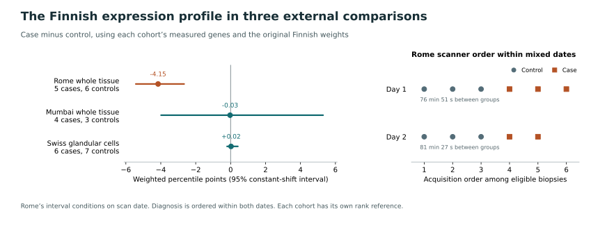

# A 12,044-gene Finnish endometriosis score reverses in Rome, where scan order separates cases and controls

**Exploratory computation on public human data, November 15, 2026.** A Finnish whole-tissue expression score moved 4.15 weighted percentile points in the opposite direction in Rome and 0.03 points in the opposite direction in Mumbai. The Rome data contain a laboratory ordering difference that affects interpretation of both the genome-wide result and the earlier pathway results. This analysis found no evidence for a reproducible positive shift in these two external cohorts. [Aggregate results](../../evidence/genome-transfer-2026-11-15/results.json) · [Analysis specification](GENOME_TRANSFER_PLAN_2026-11-15.md)



## What changed with 12,044 genes

The Finnish discovery data compare 12 cases with 13 controls across seven shared assay-run and histologic-phase groups. We used each gene's published signed permutation-standardized statistic as its weight. Within each external biopsy we summed gene percentiles multiplied by their weights, then divided by the sum of absolute measured weights. Case-minus-control differences are expressed in units of the resulting score. A positive difference means that genes weighted toward cases in Finland also tend to be higher in cases in the external study. The score has no diagnostic threshold. [Finnish data and methods](CROSS_COHORT_DISCOVERY_RESULTS_2026-11-14.md) · [Weights](../../evidence/cross-cohort-2026-11-14/discovery_gene.tsv)

| External comparison | Measured genes | Cases / controls | Score difference | Constant-shift 95% interval | Two-sided allocation reference | Holm across two primary comparisons |
| --- | ---: | ---: | ---: | ---: | ---: | ---: |
| Rome, equal weight across two mixed scan dates | 12,044 | 5 / 6 | −4.154 | −5.430 to −2.664 | 1/200 = 0.005 | 0.010 |
| Mumbai, mid-proliferative RNA-seq | 11,464 | 4 / 3 | −0.032 | −3.984 to +5.294 | 33/35 = 0.943 | 0.943 |
| Rome, original unrestricted design, sensitivity | 12,044 | 8 / 6 | −3.682 | −5.192 to −2.113 | 3/3,003 = 0.001 | — |

Every admissible single-biopsy omission in the two-date Rome analysis retained a negative difference (−4.956 to −3.352). Removing all 125 genes in the earlier nominated gene or pathway sets left 11,919 genes and a difference of −4.165. Giving every gene weight +1 or −1 according to its Finnish sign yielded −2.887. Thus, the Rome difference extended beyond the earlier nominations. Neither sensitivity selects genes by their Rome results. Mumbai estimates crossed zero under single-biopsy omissions (−0.798 to +1.334). The RNA-seq cohort has seven participants, four cases and three controls. Their seven distinct archived runs give no physical flowcell balance. Rome and Mumbai were recruited separately and used different assays. The available overlap differs by 580 genes. [Rome primary study](https://doi.org/10.1002/jcp.24358) · [Mumbai primary study](https://doi.org/10.1093/humrep/deaa255) · [Mumbai processing audit](EXTERNAL_BULK_PATHWAYS_RESULTS_2026-11-14.md)

## What the Rome instrument recorded

We parsed the native Affymetrix DAT timestamps from each of the 22 original compressed scan files, using the first 4,096 bytes per file. One scanner accounted for three dates. The analysis excludes the eight lesion arrays because each affected participant also contributed a uterine biopsy. The surgery-sampling description supports one eligible biopsy per woman. The deposited case/control field does not supply a donor-level crosswalk. [Rome source array archive](https://www.ncbi.nlm.nih.gov/geo/query/acc.cgi?acc=GSE25628) · [Clinical eligibility](GSE25628_FOSB_RESULTS_2026-11-13.md)

| Native scan day in chronological order | Uterine cases | Uterine controls | Lesions excluded | Time from last control to first uterine case |
| --- | ---: | ---: | ---: | ---: |
| First | 3 | 3 | 3 | 76 min 51 s |
| Second | 2 | 3 | 2 | 81 min 27 s |
| Third | 3 | 0 | 3 | No controls |

**Every control preceded every eligible case on both mixed dates.** Within either date an early/late division can classify diagnosis exactly. This is observed ordering, with no evidence that scan timing itself caused the human expression difference. The two-date p-value and interval assume exchangeability within date and, for the interval, a constant additive shift. The timestamps show why within-date exchangeability is scientifically questionable. Disease, upstream handling, array order, and tissue composition remain possible contributors. Neither an additional regression term nor more genes create overlapping time ranges in this design.

Re-estimating the ten previously published nomination contrasts within shared dates retained their original Rome signs. The five-pathway mean was −2.541 points within shared dates, compared with −2.426 in the unrestricted design. The earlier pathway reversal therefore survives date matching and remains entangled with within-day acquisition order. These results address the **uterine case–control subset** only. [All ten restricted and unrestricted estimates](../../evidence/genome-transfer-2026-11-15/results.json)

## Do technical probes also move?

After observing the acquisition order and genome-wide result, we checked every array probe set for the manufacturer's four external hybridization controls. These controls represent spiked-in nonhuman RNAs. We averaged the probes for each control and then averaged the four control targets equally, using the deposited RMA-normalized log2 intensities. The source does not provide individual spike-in concentrations. [Manufacturer's technical manual](https://documents.thermofisher.com/TFS-Assets/LSG/manuals/expression_analysis_manual.pdf) · [GEO matrix](https://ftp.ncbi.nlm.nih.gov/geo/series/GSE25nnn/GSE25628/matrix/GSE25628_series_matrix.txt.gz)

| Control | Probe sets | Within-date case-minus-control difference, processed log2 |
| --- | ---: | ---: |
| bioB | 6 | −0.306 |
| bioC | 4 | −0.246 |
| bioD | 4 | −0.453 |
| cre | 4 | −0.316 |
| Equal-target mean | 18 total | −0.330 |

Five of 200 date-preserving allocations produced a control-mean difference at least this extreme. All four controls shifted in the same direction. The technical measurements themselves vary with the analyzed groups. Differences in input, processing, hybridization or normalization remain possible, and this diagnostic cannot estimate how much of the weighted human score they explain. The control probes are absent from the genes used in the Finnish score.

A parallel scan-day audit of these same Rome arrays reported an average of −0.314 processed log2 units using its narrower `AFFX-r2` hybridization-control probe set (6/200 date-preserving allocations, nominal p = 0.030; Holm p = 0.090 over three post-hoc technical diagnostics). This report includes every matching hybridization-control probe set (18 probes; −0.330, 5/200 allocations, unadjusted). These are alternative feature definitions in the **same specimens**, not independent biological replications. Neither can determine what fraction of the human expression reversal is technical. [Parallel audit and its probe definition](GENOME_TRANSPORT_2026-11-15.md)

## Stage, provenance and verification

The score, primary cohort definitions, multiplicity family and gene-set omission were specified in a local note after the repository's previous Rome and Mumbai outcomes were known, before calculating the new scores. There was no prospective public registration. CEL scanner/date counts were inspected at design time. The exact within-day time gaps and external-control diagnostic were investigated after scoring. Previously published overlapping analyses include studies of both Finland and Rome. These findings identify a transfer failure and a source-design limitation. They do not establish a disease mechanism or clinical performance. [Prior analyses](CROSS_COHORT_PRIOR_EVIDENCE_2026-11-14.md)

The software reuses the repository's pinned gene-percentile loaders. Rome rankings use 22,277 complete probe sets per biopsy, followed by equal weighting of probes within each Entrez gene. Mumbai rankings use summed transcript FPKM per unique mapped Entrez gene with fixed-point arithmetic, followed by ranking within biopsy. Each inference enumerates participant labels. One allocation assigns labels to every gene together, preserving cross-gene dependence. Both primary p-values are two-sided. The Holm family contains the Rome and Mumbai primary tests only. Omission, sign-only, unrestricted, earlier nominee and technical-probe checks are sensitivity or post-hoc analyses. [Original Rome loader](../../scripts/genome_rome.py) · [Original Mumbai loader](../../scripts/bulk_gse153739.py) · [Transfer analysis](../../scripts/genome_signature_transfer.py)

The seven pinned source files and 22 bounded CEL prefixes total 33,849,615 bytes. The checksum-pinned ENA response sometimes contains the same seven rows in a different order. The acquisition script restores the exact pinned bytes only when an ordering matches their original SHA-256. The analysis source commit for the cohorts and weights was `7a566619d0c67f534ecb3a49d7d84656608764bd`. The scanner-prefix digest, Finnish weights digest and complete aggregate outputs accompany the report. [Rome file URLs and hashes](GSE25628_FOSB_RESULTS_2026-11-13.md) · [Mumbai file URLs and hashes](../../evidence/external-bulk-2026-11-14/mumbai-source.json)

```sh
python -m pip install -e '.[dev]'
python scripts/fetch_genome_transfer_sources.py --fetch
export OPENBLAS_NUM_THREADS=1
python scripts/genome_signature_transfer.py --data data/private > results-transfer.json
python scripts/verify_genome_transfer.py --data data/private --aggregate results-transfer.json
python -m pytest -q tests/test_genome_signature_transfer.py
```

The verification separately decoded the Rome timestamps, Affymetrix annotation and matrix, reconstructed within-biopsy midranks from two binary searches, and formed gene-level diagnosis contrasts before applying Finnish weights. In Mumbai it reused the original transcript mapping and independently computed gene contrasts and all 35 allocations. Both implementations agreed on the two primary effects to within 10⁻¹⁰ points, their exact tail counts and both Rome time gaps. The main Rome code also reproduced all ten published unrestricted nomination estimates. The interval inversion reuses the project's exact-rational constant-shift implementation. Execution used CPython 3.12, NumPy 2.3.5 and SciPy 1.17.0. No random seed applies. [Independent calculation](../../scripts/verify_genome_transfer.py) · [Verification receipt](../../evidence/genome-transfer-2026-11-15/verification.json)
