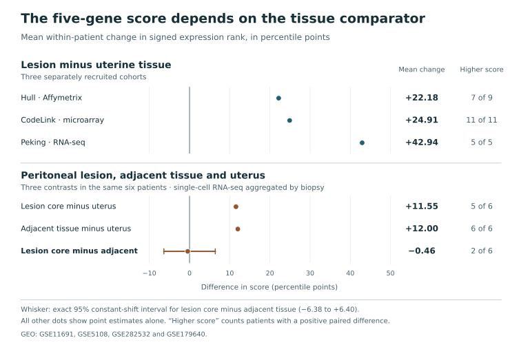
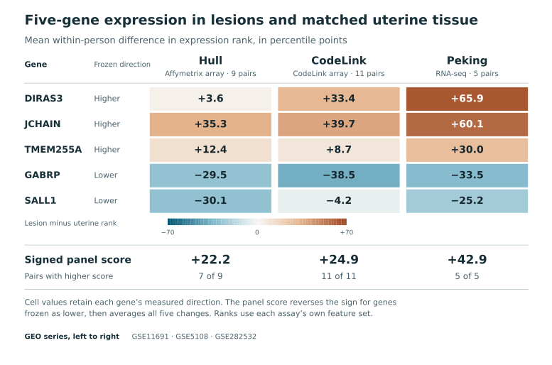

# A reproducible endometriosis tissue score also rises in nearby peritoneum

**Exploratory human-data computation, November 15, 2026.** We selected five genes using ovarian endometriomas and matched uterine tissue from ten women, fixed their directions and tested the same score in three separately recruited studies. The score was higher in lesions than in matched uterine biopsies in **23 of 25 external patients**. The evidence addresses what differs between these tissues once disease is present. The study did not enroll a screening population or compare patients with and without disease for this endpoint.

A fourth study supplied the critical comparator. Six people had sufficient data from all three sites. Using the same five genes on donor-level sums of single-cell counts, the lesion core averaged **+11.55 points** relative to uterus. Peritoneum adjacent to the lesion averaged **+12.00** relative to the same uterus. Comparing lesion core directly with adjacent peritoneum gave **−0.46 points**. Only two of six differences were positive (two-sided exact p = 56/64 = 0.875). Under a common paired shift, the exact 95% compatibility interval was **−6.38 to +6.40 points**. Three ways of handling a duplicate adjacent biopsy preserved that result. Nearby tissue can carry the score. The source does not establish histologically negative tissue at a fixed distance for every adjacent sample. Local disease effects and normal anatomy therefore remain competing explanations. [Matched three-site study](ADJACENT_PERITONEUM_RESULTS_2026-11-15.md)

## Replication across array and sequencing assays

| External cohort | Lesion samples | Independent patient pairs | Pairs in predicted direction | Mean paired score difference | Exact one-sided p |
| --- | --- | ---: | ---: | ---: | ---: |
| Hull, Affymetrix | Peritoneal or broad ligament | 9 | 7/9 | +22.18 percentile points | 19/512 = 0.0371 |
| Eyster, CodeLink | Ovarian, peritoneal and unspecified | 11 | 11/11 | +24.91 percentile points | 1/2,048 = 0.000488 |
| Peking University First Hospital, RNA-seq | Ovarian | 5 | 5/5 | +42.94 percentile points | 1/32 = 0.03125 |

The panel gives equal weight to higher **TMEM255A, DIRAS3 and JCHAIN** and lower **GABRP and SALL1**. Each specimen's gene expression is ranked against its own measured features. The score difference averages the five signed lesion-minus-uterus differences. Platforms have different feature references, so the three effect sizes and tests are reported separately. The 23/25 count is descriptive. It cannot be used as a diagnostic sensitivity. [Discovery, first validation and prior work](LESION_TRANSFER_RESULTS_2026-11-15.md) · [CodeLink source checks and results](CODELINK_PANEL_RESULTS_2026-11-15.md) · [RNA-seq replication](RNASEQ_PANEL_RESULTS_2026-11-15.md)

The wider discovery profile also transferred. A fixed weight vector over 12,498 genes gave a positive score difference in eight of nine Hull pairs (one-sided p = 0.0117). Restriction to the same 19,917 physical probes on both platforms retained that result. Four individual panel genes passed five-gene Holm correction in CodeLink. In the RNA-seq cohort, all five genes moved in their frozen directions in each of the five patients. Each individual-gene Holm p-value was 0.156. These observations are correlated across genes within each patient. The two-sided panel p in that smallest cohort was 0.0625. [All 12,498 gene comparisons](../../evidence/lesion-transfer/genes.tsv) · [Frozen five-gene selection](../../evidence/lesion-transfer/panel.json)

## Which cells contribute?

An independent spatial-transcriptomics study separated epithelium, stroma and macrophages in paired superficial lesions and uterine biopsies from five people. In epithelial regions the published lesion-minus-uterus estimates were −1.08 log2 units for GABRP and −0.85 for SALL1. GABRP exceeded the assay's quantification limit in 16 of 20 epithelial regions and in zero of 20 stromal regions. The targeted gene-by-compartment Holm p-values were 0.247 and 0.237. The other three genes rarely exceeded the assay's quantification limit. The cell source of the full score remains unresolved. [Spatial data, methods and results](SPATIAL_PANEL_RESULTS_2026-11-15.md)

## Where the evidence leads

Tan et al. had already observed broad similarity between lesion cores and adjacent peritoneum, particularly among epithelial cells. Other studies had compared the lesion and uterine datasets and examined several individual genes. Here a score chosen in different patients reproduces the broad tissue contrast and quantifies what happens to it when the comparator moves from uterus to nearby peritoneum. [Tan et al.](https://pmc.ncbi.nlm.nih.gov/articles/PMC9901845/)

Several explanations remain, including normal anatomical differences, tissue composition and a local response to the lesion. A source audit found that the four histology-negative peritoneal samples in the Fonseca atlas came from two people with confirmed endometriosis. None of the four participants without confirmed endometriosis contributed peritoneal tissue. A more discriminating comparison would score histology-verified samples from matched anatomical sites, including distant peritoneum in affected patients and peritoneum from patients without endometriosis, with matched handling and blinded scoring. [Independent atlas comparator audit](FONSECA_PERITONEUM_COMPARATOR_2026-11-15.md)

A uterine case–control comparison asked a different question. The Finnish disease-associated expression pattern reversed for 64.7% of 11,464 genes in Rome (Spearman ρ = −0.447). The reversal persisted within shared scan dates. Mumbai showed little alignment. Separately, none of five genes selected from endometrial eQTL evidence showed a corrected common-direction change in both paired lesion cohorts. [Uterine transcriptome results](TRANSCRIPTOME_TRANSFER_RESULTS_2026-11-15.md) · [Genetic anchors](GENETIC_ANCHORS_TISSUE_RESULTS_2026-11-15.md)

Two other analyses are reported on their own terms. Fifteen of 21 Indian suggestive genetic risk markers were assessable in the large earlier GWAS. None passed correction and 12 had simultaneous confidence intervals wholly within odds ratios of 0.909 to 1.10. Separately, clear-cell and endometrioid cancers made up a disproportionate share of ovarian cancers at least a decade after recorded endometriosis in Finnish, Swedish and Dutch registries. Neither result supplies a mechanism connecting the five expression genes to cancer. [Genetic portability](INDIA_GWAS_PORTABILITY_2026-11-15.md) · [Three-registry histotype analysis](LONG_LAG_OVARIAN_HISTOTYPES_2026-11-15.md)
