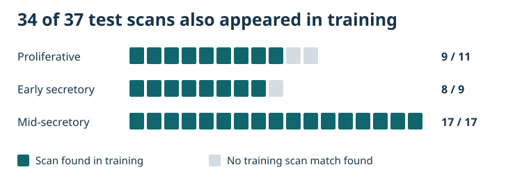

# Physical scan reuse in a published endometriosis classifier test

**November 15, 2026 · Computational reproducibility audit and exploratory array-level benchmark.** Of the 37 test scans in a published 100%-accurate endometriosis classification result, **34 also occur in the actual training set**. Every mid-secretory test scan was reused. A second route exposed test information in the released workflow. Before separating training and test arrays, the code used all 216 clinical condition labels to correct batch effects. The published predictions are indeed correct on all 37 released rows. This test cannot estimate performance on independently collected specimens whose diagnoses are unknown during preprocessing. [Study, Fig. 4B and methods](https://doi.org/10.1007/s43032-023-01359-w) · [Authors’ source revision](https://github.com/fogg-lab/characterizing-ecm-transcriptome-of-endometriosis/tree/df538583652d3359d71959437837ea3e0d1195e6) · [Issue #45](https://github.com/dovvnloading/Open-Disease/issues/45)



## Which scans crossed the split?

The authors’ clinical design file identifies 179 training arrays (15 from GSE4888, 144 from GSE51981 and 20 from GSE29981). The 37 batch-2 rows all belong to GSE6364 and agree with the 37 keys and outcome labels in the released all-matrisome test predictions. GSE51981 and GSE4888 are from the same U.S. research program as GSE6364. Inclusion was determined from the actual classifier tables, not every array ever deposited under a given accession. Here, “case” and “comparator” follow those tables. The authors' training comparator label includes some arrays from women with other pelvic pathology. [Authors’ design file](https://github.com/fogg-lab/characterizing-ecm-transcriptome-of-endometriosis/blob/df538583652d3359d71959437837ea3e0d1195e6/data_prep/metadata/coldata.tsv) · [Released predictions](https://github.com/fogg-lab/characterizing-ecm-transcriptome-of-endometriosis/blob/df538583652d3359d71959437837ea3e0d1195e6/condition_stratification_results/tabulated_results/all_phases_all_matrisome_test_results.tsv)

| Cycle phase | Test scans | Same physical scan in training | No physical match found |
| --- | ---: | ---: | ---: |
| Proliferative | 11 | 9 | 2 |
| Early secretory | 9 | 8 | 1 |
| Mid-secretory | 17 | 17 | 0 |
| All phases | 37 | **34** | **3** |

Nineteen of 21 case scans and 15 of 16 comparator scans matched. Nineteen test scans matched GSE51981 alone, eight matched GSE4888 alone, and seven appeared in both. Accordingly the 34 test scans correspond to 41 fitted training rows. All 41 pairs carried concordant condition and phase labels. All three test rows with no physical match were classified correctly. Donor identities and other possible specimen reuse are unresolved for those three. [Overlap counts](../../evidence/matrisome-holdout-2026-11-15/overlap.json)

Two implementations used different instrument evidence. The first matched each legacy CEL file on the entire native DAT image header and four grid corners, independent of file name and compression. The test scans were acquired in 2004–2005, earlier than all 2010–2011 Calvin training scans. The second decoded the first 100 physical grid-cell mean intensities in their original order in every training and test file. It compared all 37 × 179 possible test–training pairs using a common float32 representation, including 15 text-format, 115 XDA and 49 Calvin training files. Both methods gave the same set of 41 matches. This establishes measurement reuse without linking people or comparing clinical identities. The audit publishes no sample-level crosswalk. [Instrument-header audit](../../scripts/audit_matrisome_holdout.py) · [Independent cell comparison](../../scripts/verify_matrisome_cell_identity.py) · [Cell comparison results](../../evidence/matrisome-holdout-2026-11-15/cell-identity.json)

Historical control reuse was acknowledged in the original GSE6364 study. Prior researchers explicitly removed 15 GSE4888 duplicates in a different integrated analysis. The earlier Open-Disease check covered 11 proliferative arrays. The addition here is the complete physical overlap **across this classifier's actual partition**, its correspondence with the authors' published predictions, and the status of the three unmatched rows. [Burney et al.](https://doi.org/10.1210/en.2006-1692) · [Previous duplicate removal, Table 1](https://doi.org/10.7717/peerj.10171) · [Earlier proliferative audit](EXTERNAL_BULK_PATHWAYS_RESULTS_2026-11-14.md)

## Why removing the 34 predictions cannot repair the original validation

The released preprocessing notebook combined the four cohorts, called the batch correction script with the unified counts and clinical tables, read back the corrected values, and only then created its fit and test subsets. The R script builds a model matrix using each array's `condition` and passes it to ComBat while fitting the joint adjustment. All 37 designated test labels therefore enter the released preprocessing procedure, including the three unmatched scans. Using labels in this way can preserve group differences during batch adjustment. These code and input artifacts establish how the published workflow is specified. They cannot measure how much each leak contributed to accuracy or authenticate the authors' historical execution environment. No retrained original elastic-net score on new patients is available here. [Preprocessing notebook](https://github.com/fogg-lab/characterizing-ecm-transcriptome-of-endometriosis/blob/df538583652d3359d71959437837ea3e0d1195e6/data_prep/prep.ipynb) · [Batch correction](https://github.com/fogg-lab/characterizing-ecm-transcriptome-of-endometriosis/blob/df538583652d3359d71959437837ea3e0d1195e6/data_prep/batch_correction.r)

The source verifier checks the pinned notebook, R and Python implementations and both released tables. [Static trace and source checksums](../../evidence/matrisome-holdout-2026-11-15/preprocessing.json) · [Trace verification](../../scripts/verify_matrisome_preprocessing.py)

## A benchmark with the shared scans removed before fitting

We built a different fixed, cross-platform scoring rule with the authors' matrisome gene family. It asks whether the *direction* of the phase-stratified U.S. disease contrast transfers. Preprocessing is independent within each array. All fitted weights came exclusively from GSE51981, with no target expression or target labels used to fit the score. The target platforms defined which genes could be measured. We used the authors' public clinical categories and removed the 35 eligible other-pathology comparators. Of the remaining 75 case and 34 pathology-free comparator arrays, 19 cases and seven comparators also appeared in GSE6364 and were excluded, leaving **56 case and 27 comparator arrays** in training. The reference gave the three cycle phases equal weight. Of 1,026 listed symbols, 944 genes mapped on GPL570 and 688 Entrez genes qualified across all three target platforms. The complete measurement and scoring rules were recorded after the reuse result and before running this benchmark. [Local analysis design](MATRISOME_BENCHMARK_PLAN_2026-11-15.md) · [Benchmark implementation](../../scripts/matrisome_transfer_benchmark.py)

| Target | Cases / comparators | Pairs where case scored higher, scan-disjoint training | Same rule with reused scans retained in training |
| --- | ---: | ---: | ---: |
| GSE6364, proliferative | 6 / 5 | 16/30 (53%) | 19/30 (63%) |
| GSE6364, early secretory | 6 / 3 | 5/18 (28%) | 8/18 (44%) |
| GSE6364, mid-secretory | 9 / 8 | 56/72 (78%) | 60/72 (83%) |
| GSE6364, pooling only within-phase pairs | 21 / 16 | **77/120 (64%)** | **87/120 (73%)** |
| Rome, proliferative | 8 / 6 | **44/48 (92%)** | 44/48 (92%) |
| Mumbai, mid-proliferative | 4 / 3 | **2/12 (17%)** | 3/12 (25%) |

A second implementation independently mapped the GPL570 genes, derived clinical eligibility from GEO, removed matching scans using raw grid-cell measurements, and computed probe midranks by binary search. It reproduced all 688 shared genes, both sets of training phase counts, and all ten target-by-fit pair results. Both implementations use the existing Mumbai RNA-sequencing loader. [Independent benchmark verifier](../../scripts/verify_matrisome_benchmark.py)

These fractions are case–comparator rankings. Each array contributes to multiple pairs, and no accuracy threshold was trained. Each target comparison uses the same signed weights, same genes and no target-label batch correction. The three GSE6364 phases differ considerably. Rome and Mumbai favor opposite directions, and the Rome scan order perfectly separates disease groups within each of the two mixed scan days. The data allow neither a single portable classification accuracy nor an attribution of the original 100% performance to a particular source of leakage. GSE51981 lacks a donor key, the GSE6364 design includes historical controls, the array and RNA-sequencing reference universes differ, and the smaller cohorts offer limited precision. This benchmark is exploratory and cannot establish clinical discrimination. [Aggregate benchmark and shared genes](../../evidence/matrisome-holdout-2026-11-15/transfer-benchmark.json) · [Native Rome processing limitations](GENOME_TRANSPORT_2026-11-15.md)

## Reproduce

The first invocation explicitly opts in to public source retrieval. It verifies the two pinned authors' tables and each of the four original GEO inventories and their ordered 2,048-byte CEL prefixes. The optional Rome source supplies the separate technical checks. The intensity verifier requires an additional 307,200 bytes across the two Calvin archives. The two acquisition commands reuse existing caches. With the repository Python dependencies installed, run:

```sh
d=data/private/matrisome-audit
c=data/private/matrisome-calvin
python scripts/audit_matrisome_holdout.py "$d" --fetch --include-rome
python scripts/extend_calvin.py "$d" "$c"
python scripts/verify_matrisome_cell_identity.py "$d" "$c"
```

To reproduce the preprocessing trace, check out the authors’ repository at the exact revision linked above. Run `python scripts/verify_matrisome_preprocessing.py PATH_TO_AUTHOR_CHECKOUT "$d"`.

The four additional benchmark source files have the following URLs. Save them in the same directory with the local filenames shown. The runner checks every SHA-256 before parsing. The benchmark used Python 3.12.14, NumPy 2.3.5 and SciPy 1.17.0. All calculations are deterministic.

| Local filename | Publisher source |
| --- | --- |
| all_matrisome_genes.json | [Authors’ pinned feature list](https://raw.githubusercontent.com/fogg-lab/characterizing-ecm-transcriptome-of-endometriosis/df538583652d3359d71959437837ea3e0d1195e6/analysis/all_matrisome_genes.json) |
| GPL570.annot.gz | [GEO platform annotation](https://ftp.ncbi.nlm.nih.gov/geo/platforms/GPLnnn/GPL570/annot/GPL570.annot.gz) |
| GSE51981.gz | [GEO processed GSE51981 matrix](https://ftp.ncbi.nlm.nih.gov/geo/series/GSE51nnn/GSE51981/matrix/GSE51981_series_matrix.txt.gz) |
| GSE6364.gz | [GEO processed GSE6364 matrix](https://ftp.ncbi.nlm.nih.gov/geo/series/GSE6nnn/GSE6364/matrix/GSE6364_series_matrix.txt.gz) |

Use the pinned Rome matrix and platform annotation, the official Mumbai RNA-sequencing inputs and HGNC release from the linked source receipts. GEO describes public access subject to third-party rights. We used the authors’ release to examine reported computations and published aggregate outputs. Raw and participant-level files remain in ignored private paths. [Rome inputs](GSE25628_FOSB_RESULTS_2026-11-13.md) · [Mumbai inputs](../../evidence/external-bulk-2026-11-14/mumbai-source.json) · [Source usage guidance](https://www.ncbi.nlm.nih.gov/geo/info/disclaimer.html)

```sh
b=data/private/matrisome-benchmark
r=data/private/gse25628
m=data/private/gse153739
h=data/private/hgnc/hgnc_complete_set_2026-10-06.tsv
python scripts/matrisome_transfer_benchmark.py "$b" "$d" "$r" "$m" "$h"
python scripts/verify_matrisome_benchmark.py "$b" "$d" "$c" "$r" "$m" "$h" \
  evidence/matrisome-holdout-2026-11-15/transfer-benchmark.json
```
