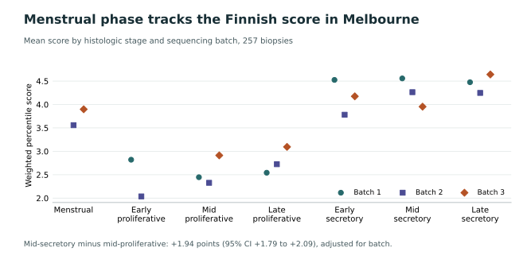

# Histologic cycle stage tracks the Finnish expression score in 257 Melbourne biopsies

**Exploratory analysis of human RNA-seq, November 15, 2026.** In 257 separately identified biopsies, seven histologic cycle stages explained **71.49% of the variation in the Finnish endometriosis expression score left after accounting for sequencing batch**. Mid-secretory biopsies averaged 1.94 weighted percentile points above mid-proliferative biopsies (HC3 95% interval 1.79 to 2.09). This RNA-seq archive measures how strongly the score tracks cycle stage. Its public sample records lack a case/control diagnosis. [Aggregate results](../../evidence/genome-transfer-2026-11-15/melbourne-phase.json) · [GEO GSE234354](https://www.ncbi.nlm.nih.gov/geo/query/acc.cgi?acc=GSE234354) · [Primary study](https://doi.org/10.1038/s41467-023-41979-z)



## Measurement and biological interpretation

The Finnish weights came from 12 affected and 13 comparison participants in seven assay-run and histologic-phase groups. For this separate Australian population we used all 11,995 Finnish genes with a unique approved HGNC mapping to measured Melbourne genes. They retain 99.56% of the original absolute weight. The source contains a count for each of 58,302 Ensembl genes in every assay. We retained 41,278 uniquely mapped genes as the background, ranked their counts within each biopsy with average ranks at ties, and calculated the Finnish-weighted mean of the resulting percentiles. No genes or weights were fitted to the Melbourne outcome. Fixed gene-length biases and differing measurement platforms limit cross-study comparisons of magnitudes. [Finnish discovery data](../../evidence/cross-cohort-2026-11-14/discovery_gene.tsv) · [Source count matrix](https://ftp.ncbi.nlm.nih.gov/geo/series/GSE234nnn/GSE234354/suppl/GSE234354_gene_count_matrix.txt.gz)

| Melbourne sequencing batch | All phase-dated biopsies | Mid-proliferative | Mid-secretory | Mid-secretory minus mid-proliferative, score points |
| --- | ---: | ---: | ---: | ---: |
| 1 | 31 | 13 | 8 | +2.110 |
| 2 | 208 | 73 | 35 | +1.936 |
| 3 | 18 | 7 | 1 | +1.041 |
| Within-batch common contrast | 257 overall | 93 | 44 | **+1.939** |

The seven stages comprised 16 menstrual, 5 early-proliferative, 93 mid-proliferative, 26 late-proliferative, 39 early-secretory, 44 mid-secretory and 34 late-secretory biopsies. The primary test allowed for a separate mean for each of the three RNA-seq batches. It asked whether adding six independent stage indicators explained more variance than permuting the biopsy scores within their sequencing batches. Zero of 49,999 random allocations exceeded the observed improvement. The plus-one Monte Carlo estimate is **0.000020**, the smallest value this run could resolve. Stage 3 and stage 6 were the only prespecified pairwise contrast. Its interval uses heteroscedasticity-consistent HC3 standard errors and 133 residual degrees of freedom. Batch 3 has only one mid-secretory biopsy. The complete cell counts and means accompany the analysis.

The result identifies cycle sensitivity in the **particular weighted profile that had been proposed to travel across cohorts**. Endometrial transcriptomes were already known to vary across the cycle. A strong cycle association in a separate population gives a reason to investigate finer timing and cell-composition differences when interpreting the disease score. It does not demonstrate that stage caused the Finland–Rome discrepancy. Rome sampled only broadly proliferative biopsies, while this test includes the entire cycle. Within the primary Melbourne study, when pathology recorded only proliferative or secretory stage, the authors assigned the corresponding mid-phase. Remaining within-stage timing, collection method, clinic and any diagnosis differences are unresolved. The comparisons are cross-sectional. [Original staging definitions](https://doi.org/10.1038/s41467-023-41979-z) · [Rome and Mumbai disease-score results](GENOME_TRANSFER_RESULTS_2026-11-15.md)

## Biopsies, repeats and the missing diagnosis

The accession contains 295 RNA-seq libraries on two Illumina platforms. The source authors explicitly identify technical replicates by the original biopsy name within the library title. Applying that rule produced 272 distinct biopsy keys. All 23 repeat pairs had a single phase-dated library and a second library lacking phase. An additional 15 distinct biopsies had no histologic stage at all. Every analyzed library had a unique original biopsy key, SRA experiment and BioSample. Teh et al. describe recruiting 358 subjects and collecting 358 samples across their combined RNA-seq and microarray studies. An independently audited person-to-visit crosswalk is unavailable. Inferential estimates assume independent biopsies and exchangeability of scores within batch under the null. [Author replicate code](https://github.com/jessicachung/endo_model_paper/blob/master/src/1.01_counts_eda.Rmd) · [Sample records](https://www.ncbi.nlm.nih.gov/geo/query/acc.cgi?acc=GSE234354&targ=gsm&view=brief&form=text)

A subsequent study analyzed 206 Melbourne women, including 143 cases and 63 controls, and cites this same RNA-seq deposit. All 295 deposited records carry tissue, age, cycle stage, postovulatory day and sequencing batch. They do not include a diagnosis that identifies members of either group. The released analysis code references separate phenotype objects outside its source tree. We also checked the 28 worksheets in the 2023 study's source-data workbook and the 2025 study's cohort-comparison supplements. These give sample-linked time, expression and covariates for figures, or selected transcript and splicing contrasts. They do not recover the needed diagnosis-to-biopsy mapping. The original 229-person Melbourne microarray study is represented in the later combined cohort. Teh et al. report 198 samples with both RNA-seq and microarray measurements. This source cannot count as a new independent Melbourne disease replication. [206-person study and availability](https://doi.org/10.1016/j.isci.2025.113207) · [Author analysis code](https://github.com/jessicachung/endo_model_paper/blob/master/src/1.08_dge.Rmd) · [Earlier Melbourne assessment](MELBOURNE_FIVE_GENE_RESULTS_2026-11-14.md)

## Reproduction

The stage test and the mid-secretory versus mid-proliferative contrast were written down after inspecting metadata and the earlier Rome/Mumbai results, before reading Melbourne counts. This was a local analysis specification without public preregistration. GSE234354 and the primary paper had already published cycle effects for other measures. [Contemporaneous specification](MELBOURNE_PHASE_PLAN_2026-11-15.md)

```sh
python -m pip install -e '.[dev]'
export OPENBLAS_NUM_THREADS=1
python scripts/melbourne_signature_phase.py --fetch > melbourne-phase.json
python scripts/verify_melbourne_signature_phase.py --aggregate melbourne-phase.json
python -m pytest -q tests/test_melbourne_signature_phase.py
```

The code verifies SHA-256 for the 14,249,644-byte matrix and HGNC snapshot, and for a sorted projection of the source sample, phase, batch and accession mappings. Input URLs are in the code. The source HGNC annotation had been acquired for Mumbai, so the Melbourne expression and specimen files added 14,993,764 bytes. The independent calculation uses a different count/annotation parser, recomputes quantiles by binary searches in each ordered sample, fits nested regression models, and calculates the contrast using within-batch residuals. Neither procedure outputs individual biopsy values. [Analysis](../../scripts/melbourne_signature_phase.py) · [Independent verification](../../scripts/verify_melbourne_signature_phase.py) · [Verification result](../../evidence/genome-transfer-2026-11-15/melbourne-verification.json)
