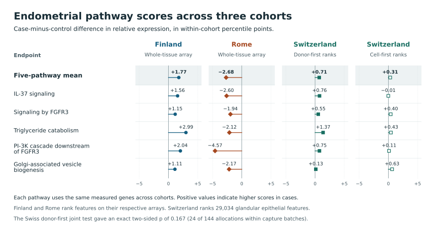

# Five endometriosis pathway scores in Swiss glandular epithelial cells

**Exploratory human-data computation, November 14, 2026.** All five prespecified pathway scores were higher in cases in Swiss proliferative glandular cells, the direction seen in Finnish whole tissue. Their average was **+0.71 percentile points**. Of 144 possible ways to assign disease labels while preserving the case count in each capture batch, 24 yielded a difference at least this extreme in either direction (**p = 0.167**). The prespecified joint test and all five adjusted component tests fell short of the 0.05 threshold. The main result is a directional observation in 13 independent donors with substantial uncertainty. [Protocol committed before Swiss outcomes](https://github.com/dovvnloading/Open-Disease/commit/7f380a743491e98036b200bd6c2d097d7bd489cd) · [Primary numerical results](../../evidence/swiss-glandular-2026-11-14/results.json) · [Source study](https://doi.org/10.1038/s41467-026-73020-4)

## What was measured

Duempelmann et al. collected uterine biopsies before surgery in Switzerland. Cases had surgical and histopathologic confirmation, and the study excluded recent exogenous hormone use. The authors' proliferative differential-expression population comprised 12 cases and 11 controls. The public epithelial trajectory subset retained 10 and 11, respectively. Glandular cells were the only one of seven refined states with at least 20 cells per eligible donor and case–control overlap in at least two capture batches. Excluding single-group batches left **six cases and seven controls in four capture batches**, each nested in a sequencing batch. The analysis includes **3,564 glandular cells**. The donor is the unit of inference. Subtype selection used only specimen metadata and cell counts. [Recruitment, sample processing and data availability](https://doi.org/10.1038/s41467-026-73020-4) · [Clinical and assay audit](GSE266265_EPITHELIAL_FEASIBILITY_2026-11-14.md)

For each donor, we summed the released SCT depth-corrected counts across their glandular cells and ranked the 29,034 features, retaining zero ties. A pathway score averages the relative expression percentiles of its mapped genes. A shift of one point is a change of one percentile point on this rank scale. It has no fixed conversion to RNA concentration, fold change, protein abundance or signaling activity. Each capture batch contributed equal weight to the case-minus-control difference. The five pathways had been selected in Finland before the Rome study. The new equal-weight mean, two-sided test, component correction and sensitivities were specified separately before calculating Swiss outcomes. [Original candidate lock](https://github.com/dovvnloading/Open-Disease/commit/f2a3755ff055cde241e0eaaaedc11a1471270beb) · [Swiss analysis plan](SWISS_GLANDULAR_PLAN_2026-11-14.md) · [SCT assay documentation](https://satijalab.org/seurat/reference/sctransform)

## All prespecified estimates

All differences below are case minus control, in percentile points. The omission range spans the estimates obtained by excluding one entire capture batch at a time. The last column ranks features within each cell before averaging them within donors. Only the primary column entered the formal tests.

| Endpoint | Genes mapped / locked | Primary difference | Extreme assignments / 144 | Two-sided p | Five-pathway Holm p | Omit-one-batch range | Cell-first difference |
| --- | ---: | ---: | ---: | ---: | ---: | ---: | ---: |
| **Five-pathway mean** | **111 distinct mapped genes** | **+0.709** | **24** | **0.167** | — | **+0.405 to +1.028** | **+0.309** |
| Interleukin-37 signaling | 18 / 19 | +0.761 | 14 | 0.097 | 0.486 | +0.707 to +0.844 | −0.014 |
| Signaling by FGFR3 | 33 / 38 | +0.546 | 94 | 0.653 | 1.000 | −0.158 to +1.086 | +0.396 |
| Triglyceride catabolism | 18 / 21 | +1.369 | 29 | 0.201 | 0.806 | +0.700 to +1.958 | +0.428 |
| PI-3K cascade downstream of FGFR3 | 15 / 18 | +0.746 | 55 | 0.382 | 1.000 | +0.274 to +1.012 | +0.105 |
| Golgi-associated vesicle biogenesis | 43 / 43 | +0.125 | 112 | 0.778 | 1.000 | −0.318 to +0.632 | +0.630 |

The positive overall estimate survived every single-batch omission and both scoring orders. Triglyceride catabolism had the largest primary difference. IL-37 had the smallest unadjusted p-value but its difference fell essentially to zero under cell-first ranking. Two pathway estimates changed sign under batch omission. All 15 mapped PI-3K cascade members also belong to the 33-gene FGFR3 set. Counting the five observed signs as five independent pieces of evidence would overstate their information. With 144 assignments, only one extreme assignment could pass the first Holm cutoff of 0.01. [All aggregate estimates and exact tails](../../evidence/swiss-glandular-2026-11-14/results.json) · [Membership checks](../../evidence/swiss-glandular-2026-11-14/mapping.json)

## What the comparison across cohorts resolves

We recalculated the earlier Finnish and Rome scores using exactly the pathway members measured in Switzerland. All five pathways remained higher in Finnish whole tissue and lower in Rome whole tissue. Missing Swiss gene annotations therefore do not account for that specific disagreement. The matched-member five-pathway means were +1.77 points in Finland, −2.68 in Rome and +0.71 in Swiss glandular cells. The platforms have different rank references, and the whole-tissue studies include other cell types. These contrasts cannot isolate a tissue-composition effect or establish which study reflects a general disease pattern. The original external validation in Rome remains unsuccessful. [Matched-member estimates](../../evidence/swiss-glandular-2026-11-14/prior-cohorts.json) · [Original two-cohort screen](CROSS_COHORT_DISCOVERY_RESULTS_2026-11-14.md)



## Precision and scope

After observing the primary result, we added a descriptive precision calculation for the five-pathway mean. We inverted the same exact two-sided test under a constant additive difference in donor scores and exchangeability of labels within capture batch. The resulting **95% compatibility interval is −0.44 to +1.38 percentile points**. Both a small negative difference and a larger positive difference are compatible with these data under those assumptions. The calculation counted 8 of 144 assignments at each boundary and 7 immediately outside. The interval describes a common shift on this score, while differences that vary between donors or batches require other assumptions. This addition had no role in the prospective decision. [Exact bounds and checks](../../evidence/swiss-glandular-2026-11-14/global-interval.json)

The 13 women form a restricted, phase-specific subset of a surgical population. Residual differences in recruitment, pathology, cell yield or other covariates could affect the estimates. Zero ties and varying feature detection affect relative ranks. The released trajectory excludes ciliated, mesothelial and MUC5B-positive populations. It cannot determine the proportion of all uterine cells that are glandular. The source authors used the RNA assay for their own differential-expression analysis. We used the separately documented SCT-derived counts without fitting a raw-count model. Earlier human studies already examined IL-37 in endometriosis. This work adds an independently recruited cohort and a reproducible glandular comparison; it does not establish biological novelty, mechanism or a diagnostic marker. [Assay derivation](GSE266265_EPITHELIAL_FEASIBILITY_2026-11-14.md) · [Prior evidence on the nominated pathways](CROSS_COHORT_PRIOR_EVIDENCE_2026-11-14.md)

## Reproduction

The two source-pinned calculations agreed on all six exact tail counts, all five Holm adjustments, both types of pathway estimate and both batch-omission bounds. The second implementation reconstructed individual sparse columns from the same RDS, ranked a dense vector with integer searches and calculated contrasts with exact rational arithmetic. They share the workbook extraction, original nomination and gene mapping. Independent enumeration also checked all 144 candidate-to-gene mapping rows. Across the 78 donor-by-endpoint values in each scoring order, the largest implementation discrepancy was under 6 × 10⁻¹⁴ points. Only aggregate values enter the repository. [Primary and independent analysis code snapshot](https://github.com/dovvnloading/Open-Disease/commit/513d31ba7a2e78507dbbcd21fe07c7612839a10b)

Use base R and the project Python environment with openpyxl. Obtain the two original public study files linked in the [previous source receipt](GSE266265_EPITHELIAL_FEASIBILITY_2026-11-14.md) and the [HGNC archive](https://storage.googleapis.com/public-download-files/hgnc/archive/archive/quarterly/tsv/hgnc_complete_set_2026-10-06.tsv). Preserve the HGNC filename. The RDS, workbook, annotation, original lock and feature axis are checksum-verified. HGNC is CC0. Reactome memberships are derived from release 98 under CC BY 4.0. [Projection receipt and hashes](../../evidence/swiss-glandular-2026-11-14/mapping.json) · [Reactome provenance and attribution](CROSS_COHORT_DISCOVERY_RESULTS_2026-11-14.md) · [HGNC terms](https://www.genenames.org/about/license/)

```bash
d=data/private/gse266265
rds="$d/GSE266265_epithelial_cells_monocle3.rds"
clinical="$d/41467_2026_73020_MOESM3_ESM.xlsx"
out=results/swiss-glandular-pathways
mkdir -p "$out"
export OPENBLAS_NUM_THREADS=1
Rscript scripts/r/extract_swiss_feature_labels.R "$rds" "$d/row_labels.txt"
python scripts/swiss_epithelial_mapping.py "$d" --out "$d/projection.tsv" --receipt "$out/mapping.json"
python scripts/verify_swiss_glandular.py "$rds" "$clinical" "$d/projection.tsv" > "$out/independent.json"
python scripts/analyze_swiss_glandular.py "$rds" "$clinical" "$d" \
  --compare "$out/independent.json" --output "$out/results.json"
python scripts/swiss_global_interval.py "$rds" "$clinical" "$d" > "$out/global-interval.json"
python scripts/swiss_prior_cohorts.py data/private --out "$out/prior-cohorts.json"
python scripts/plot_swiss_glandular.py
```

The prior-cohort command additionally uses the cached Finnish and Rome sources, including inflate64 for the original Finnish archive. Their acquisition instructions appear in the original screen. The plot requires matplotlib. The primary runner and independent check used Python 3.12.14, NumPy 2.3.5, SciPy 1.17.0, openpyxl 3.1.5 and base R 4.5.0. The verified primary run took 13.33 s and peaked at 1,410,988 KiB. The independent computation took 7.6 s. The two human source files were already cached. The new HGNC transfer was 16,973,125 bytes. These analyses enumerate assignments without a random seed.
